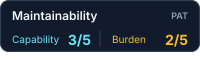
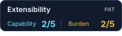

# PAT — Project Assessment Toolkit

[](docs/PROJECT_ASSESS.md#github-badges)
[](docs/PROJECT_ASSESS.md#github-badges)
[](docs/PROJECT_ASSESS.md#github-badges)
[](docs/PROJECT_ASSESS.md#github-badges)

Understand a project's engineering capability and upkeep burden, choose goals that fit, and see progress toward them.

PAT assesses **security, testing, documentation, maintainability, delivery, operability and extensibility**. Each has independent 0–5 capability and burden ratings: adding missing protection and removing needless upkeep can both improve a project. Missing evidence stays unknown. Counts never assign scores.

PAT runs without an AI service. Local scans collect facts; a person or optional agent supplies cited judgment. `doctor` surfaces review candidates, and `evolve` derives a small next-step plan from saved reviews and user-selected goals. Neither automatically rates, changes goals or repairs source.

## Start from source

Requires macOS or Linux, Python 3.11+ and [uv](https://docs.astral.sh/uv/).

```bash
git clone https://github.com/gburch/project-assessment-toolkit.git
cd project-assessment-toolkit
uv sync --locked
uv run --locked pat --state-dir /path/outside/repos/pat-state scan /path/to/project
uv run --locked pat --state-dir /path/outside/repos/pat-state list
uv run --locked pat --state-dir /path/outside/repos/pat-state report ASSESSMENT_ID --format markdown
uv run --locked pat --state-dir /path/outside/repos/pat-state doctor ASSESSMENT_ID
uv run --locked pat --state-dir /path/outside/repos/pat-state evolve ASSESSMENT_ID
uv run --locked pat --state-dir /path/outside/repos/pat-state serve --open
```

The local app displays evidence, ratings, editable goals and progress. Keep state outside assessed repositories: it contains captured source excerpts, reviews and goals. A scan reads source and supplied reports without executing the project, loading its plugins or changing its files.

To add ratings, use `review-template`, inspect `evidence` and `rubric`, then submit the completed JSON with `review --input FILE`. The optional [project-assess skill](.agents/skills/project-assess/SKILL.md) guides that review. Confirm the goals you want before saving them; a profile is a suggestion, and changing a target is not engineering progress.

## Right-size the work

`doctor ASSESSMENT_ID` groups captured hints into reuse, quality and efficiency candidates. Inspect source and actual callers before treating a hint as a problem. `evolve ASSESSMENT_ID` can recommend strengthening, simplifying, rebalancing or maintaining a dimension. Without selected goals it asks for their selection and saves nothing.

Challenge architecture and rules against demonstrated requirements. Earlier AI decisions are revisable; security, durable-data and integration guarantees still matter. Extensibility may mean a small function or configuration seam rather than a plugin system. A high-capability, low-burden practice can stay as it is.

The [user guide](docs/PROJECT_ASSESS.md) covers reviews, goal profiles, progress, local state and MCP. The [simplification](.agents/skills/project-assess/references/simplify-review.md) and [Evolve](.agents/skills/project-assess/references/evolve-review.md) references guide bounded changes within authorized implementation work.

## Optional evidence tools and agents

- `doc-value` and `doc-value-nav` inspect documentation and record bounded audit/navigation evidence.
- `test-value inventory` collects static test leads. `test-value` and `test-value-js` runtime collection execute explicitly selected tests in the project's environment **only when the owner requests that operation**. Scan never runs them automatically.
- The optional `mcp` extra exposes the same local assessment service over stdio with explicit allowed roots. No cloud credentials or AI API key are required.

Run `uv run --locked pat skills` to locate the bundled assessment, documentation and test-value skills. Import supported reports with `pat scan --report FILE`; supplied claims remain distinct from verified source identity. AST, lexical and overlap hints do not establish correctness, safe deletion or deployed security. See the guide's [limits](docs/PROJECT_ASSESS.md#agent-connection-and-limits).

The Python distribution is `pat-assess`, the canonical CLI is `pat`, and the Python package is `project_assess`. The `project-assess` CLI alias and skill name remain available for compatibility. The core dependency is `jsonschema`; MCP is optional.

## GitHub badges

Export a saved assessment to SVG, then commit the file with a relative image link in your README:

```bash
mkdir -p docs/badges
uv run --locked pat --state-dir /path/outside/repos/pat-state badge ASSESSMENT_ID \
  --dimension testing > docs/badges/testing.svg
```

```markdown

```

Badges show separate capability (`C`, higher) and burden (`B`, lower) ratings, with `?` for unknowns. They are static snapshots: regenerate after saving a new review. Exported metrics and metadata are public when committed; private evidence, rationale and paths are excluded. See the [badge guide](docs/PROJECT_ASSESS.md#github-badges) for summary badges, JSON and publication details.

## Contribute and report problems

See [CONTRIBUTING.md](CONTRIBUTING.md) for setup and focused checks, and [SECURITY.md](SECURITY.md) for private vulnerability reporting. Public issues and pull requests should use synthetic examples, without private source, assessment exports or credentials.

Licensed under [MIT](LICENSE).

## Dedication

I named PAT after my dad, so he can keep helping me clean up my messes even though he is gone.
