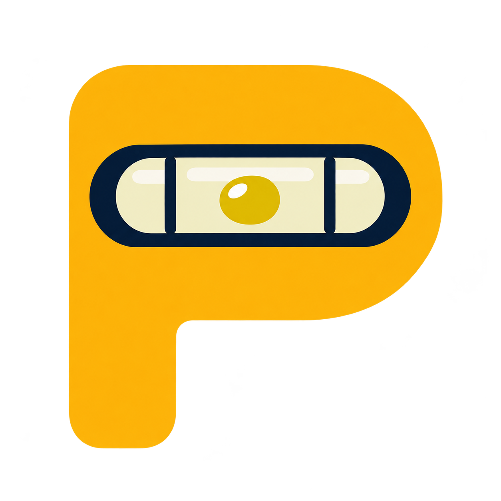

<p align="center">
  
</p>
<h1 align="center">PAT</h1>
<p align="center"><strong>Project Assessment Toolkit</strong><br>Find the right balance.</p>
<p align="center">
  <a href="LICENSE"></a>
  <a href="pyproject.toml"></a>
</p>
<p align="center">
  <a href="docs/PROJECT_ASSESS.md">Guide</a> ·
  <a href="CONTRIBUTING.md">Contribute</a> ·
  <a href="https://github.com/gburch/project-assessment-toolkit/issues">Issues</a> ·
  <a href="SECURITY.md">Security</a>
</p>

PAT helps you see what works, what costs too much to maintain, and what to improve next. Choose goals that fit your project and track progress toward them.

Assess **security, testing, documentation, maintainability, delivery, operability and extensibility** on two independent 0–5 scales: **capability** and **upkeep burden**. A project can need stronger tests, fewer brittle fixtures, or both. Useful capability has no penalty. Missing evidence stays **unknown**; counts never assign scores.

PAT runs locally without an AI service. Scans collect facts; a person or optional agent supplies cited judgment.

## From evidence to a next step

| Step | What you get |
| --- | --- |
| **Scan** | Capture source facts and supplied reports without executing the project or changing its files. |
| **Review** | Add capability and burden ratings supported by the captured evidence. |
| **Goals** | Choose capability minimums and burden ceilings, then compare later assessments. |
| **Doctor / Evolve** | Inspect reuse, quality and efficiency candidates; plan a bounded next step against selected goals. |

Doctor and Evolve provide advice. They do not assign ratings, save goals or repair source automatically. A target edit changes the goal, not the observed project.

## Get started from source

Requires macOS or Linux, Python 3.11+ and [uv](https://docs.astral.sh/uv/).

```bash
git clone https://github.com/gburch/project-assessment-toolkit.git
cd project-assessment-toolkit
uv sync --locked
uv run --locked pat --state-dir /path/outside/repos/pat-state scan /path/to/project
uv run --locked pat --state-dir /path/outside/repos/pat-state list
uv run --locked pat --state-dir /path/outside/repos/pat-state report ASSESSMENT_ID --format markdown
uv run --locked pat --state-dir /path/outside/repos/pat-state serve --open
```

The local app displays evidence, ratings, editable goals and progress. **Keep state outside assessed repositories:** it contains captured source excerpts, reviews and goals.

Follow the [local workflow](docs/PROJECT_ASSESS.md#local-workflow) to fill a `review-template`, inspect `evidence` and `rubric`, and submit the review. The optional [assessment skill](.agents/skills/project-assess/SKILL.md) guides the same process. Choose goals explicitly; profiles are starting suggestions.

## PAT's own assessment

<p>
  <a href="docs/badges/README.md"></a>
  <a href="docs/badges/README.md"></a>
  <br>
  <a href="docs/badges/README.md"></a>
  <a href="docs/badges/README.md"></a>
</p>

These are saved snapshots, not live status or a security certification. [Read the self-assessment](docs/badges/README.md). Capability and upkeep burden stay separate; `?` means unknown.

Export saved assessments as badges for your own README. See the [badge guide](docs/PROJECT_ASSESS.md#github-badges) for SVG, JSON, regeneration and the metadata made public by an export.

## Optional tools and agents

- [Documentation tools](docs/PROJECT_ASSESS.md#documentation-evidence-and-navigation): `doc-value` and `doc-value-nav` inspect documentation and navigation evidence.
- [Test-value tools](docs/PROJECT_ASSESS.md#test-value-evidence): static inventory and explicitly requested runtime test evidence. Scanning never runs tests automatically.
- [MCP and bundled skills](docs/PROJECT_ASSESS.md#agent-connection-and-limits): connect an agent to the same local service with explicit allowed roots. No cloud credentials or AI API key are required.

The CLI is `pat`, the Python distribution is `pat-assess`, and the package is `project_assess`. The `project-assess` command alias and skill name remain available for compatibility. Read the [guide](docs/PROJECT_ASSESS.md) for evidence limits, source identity and local state.

## Contribute

Read [CONTRIBUTING.md](CONTRIBUTING.md) for setup and focused checks. Use [issues](https://github.com/gburch/project-assessment-toolkit/issues) for bugs and suggestions, and follow [SECURITY.md](SECURITY.md) for private vulnerability reporting. Share synthetic examples rather than private source, assessment exports or credentials.

[Code of conduct](CODE_OF_CONDUCT.md) · [Support](.github/SUPPORT.md) · [MIT license](LICENSE)

## Dedication

I named PAT after my dad, so he can keep helping me clean up my messes even though he is gone.
