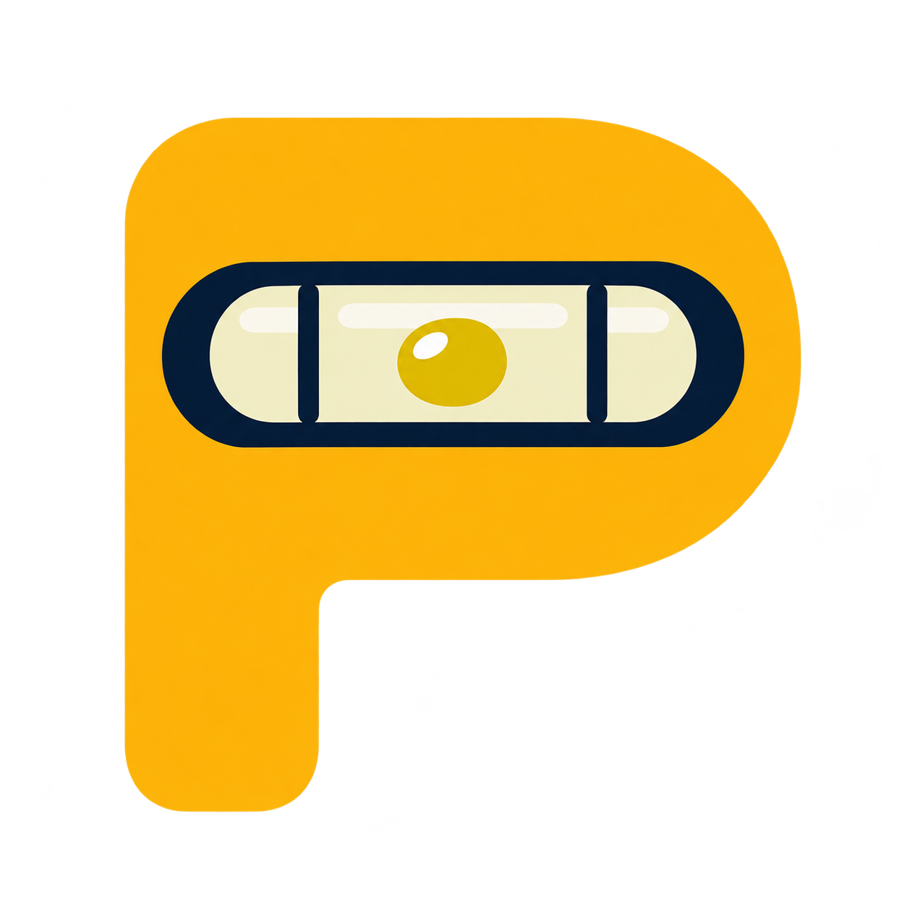
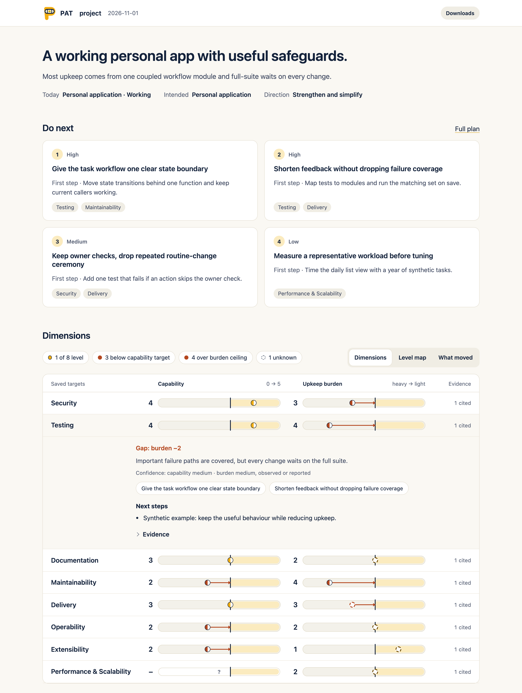
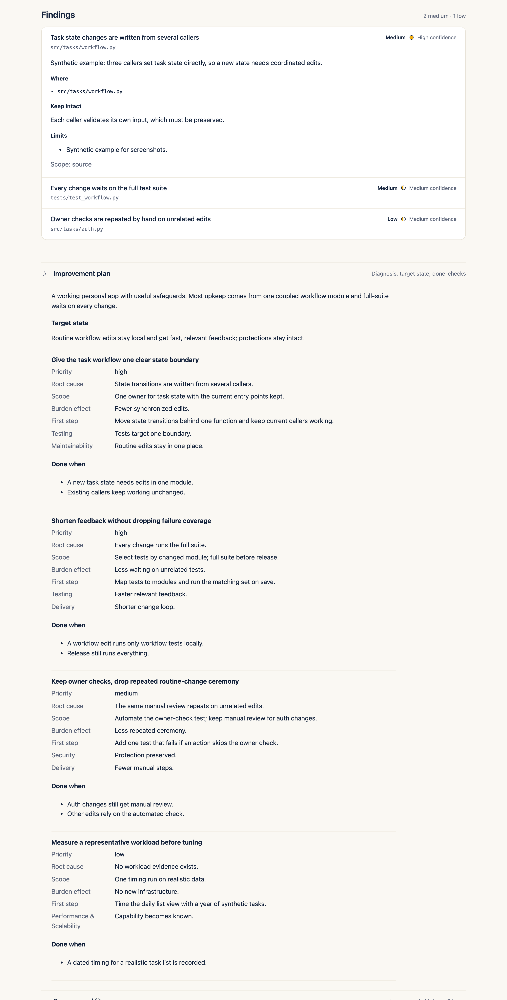

<p align="center">
  
</p>
<h1 align="center">PAT</h1>
<p align="center"><strong>Project Assessment Toolkit</strong><br>Find the right balance.</p>
<p align="center">
  <a href="LICENSE"></a>
  <a href="pyproject.toml"></a>
</p>
<p align="center">
  <a href="docs/PROJECT_ASSESS.md">Guide</a> ·
  <a href="CONTRIBUTING.md">Contribute</a> ·
  <a href="https://github.com/gburch/project-assessment-toolkit/issues">Issues</a> ·
  <a href="SECURITY.md">Security</a>
</p>

PAT helps you see what works, what costs too much to maintain, and what to improve next. Choose goals that fit your project and track progress toward them.

Assess **security, testing, documentation, maintainability, delivery, operability, extensibility and performance/scalability** on two independent 0–5 scales: **capability** and **upkeep burden**. A project can need stronger tests, fewer brittle fixtures, or both. Useful capability has no penalty. Missing evidence stays **unknown**; counts never assign scores.

PAT runs locally without an AI service. Scans collect facts; a person or optional agent supplies cited judgment.

Recommendations also account for **current maturity and intended purpose**. PAT's
`project-maturity` and `project-intent` skills establish the project's present
scope/readiness, distinguish owner-stated goals from documented or inferred
ambitions, and rank the work that fits that destination. A dependable personal
utility can be complete; commercial or platform scope is not automatically better.

## What a report looks like

Each report leads with a verdict and ranked next steps, then shows every dimension
against its target. Evidence and caveats stay one click down. **This preview uses synthetic data, not an
assessment of a real project.** Click either screenshot to view it at full size.

<p align="center">
  <a href=".github/assets/report-overview.png"></a>
</p>

The example is a **working personal application** whose owner wants dependable
daily workflows with low upkeep. Its priorities are to simplify coupled workflow
changes, shorten test feedback and reduce repeated security ceremony while
preserving useful protections. Platform features can wait.

| Example area | Capability | Burden | What to focus on |
| --- | --- | --- | --- |
| Maintainability | 2/5 | 4/5 | Give a coupled workflow one clear state boundary so routine edits stay local. |
| Testing | 4/5 | 4/5 | Keep important failure coverage while reducing repeated full-suite waits. |
| Security | 4/5 | 3/5 | Preserve authorization and data protections with fewer repeated routine-change checks. |
| Performance & Scalability | Unknown | 2/5 | Measure a representative workload before adding caching or infrastructure. |

Strong testing capability can coexist with obstructive upkeep. This example's
testing goal is capability **at least 3/5** and burden **at most 2/5**: keep the
useful capability and reduce the burden. Unknown performance capability remains
unknown rather than becoming a zero.

<details>
<summary>See example findings and the improvement plan</summary>

<p align="center">
  <a href=".github/assets/report-details.png"></a>
</p>

Findings carry evidence references, confidence, counterevidence and limits.
Recommendations identify the cause, scope, expected burden direction, acceptance
evidence and a first useful slice; they do not promise an automatic score increase.

</details>

## From evidence to a next step

| Step | What you get |
| --- | --- |
| **Scan** | Capture source facts and supplied reports without executing the project or changing its files. |
| **Review** | Add capability and burden ratings supported by the captured evidence. |
| **Goals** | Choose capability minimums and burden ceilings, then compare later assessments. |
| **Doctor / Evolve** | Inspect reuse, quality and efficiency leads; read the diagnosis, coverage and full roadmap before choosing a first implementation slice. |

Doctor and Evolve provide advice. They do not assign ratings, save goals or repair source automatically. A target edit changes the goal, not the observed project.

## Get started from source

Requires macOS or Linux, Python 3.11+ and [uv](https://docs.astral.sh/uv/).

```bash
git clone https://github.com/gburch/project-assessment-toolkit.git
cd project-assessment-toolkit
uv sync --locked
uv run --locked pat info
uv run --locked pat analyzers
uv run --locked pat --state-dir /path/outside/repos/pat-state scan /path/to/project --brief
uv run --locked pat --state-dir /path/outside/repos/pat-state list
uv run --locked pat --state-dir /path/outside/repos/pat-state report ASSESSMENT_ID --brief
uv run --locked pat --state-dir /path/outside/repos/pat-state serve --open
```

The local app can scan a project, inspect evidence, load or import a cited JSON review, submit it and save goals. It also shows ratings, history and progress. **Keep state outside assessed repositories:** it contains captured source excerpts, reviews and goals.

Follow the [local workflow](docs/PROJECT_ASSESS.md#local-workflow) to fill a `review-template`, inspect `evidence` and `rubric`, and submit the review. The optional [assessment skill](.agents/skills/project-assess/SKILL.md) carries a request to "run PAT" through to a substantive inline scorecard, cited findings and improvement plan; scan counts and links alone are collection output. Choose goals explicitly; profiles are starting suggestions, not a prerequisite for the assessment.

Deep scans include dead-code and documentation-drift checks, agent instructions,
dimension-specific inspection plans and bounded local change history. They request
Vulture and Joern automatically when their trusted runtimes are available; missing
setup and bounded analysis remain explicit gaps. Documentation and skills are
development inputs whose drift can affect several dimensions. Representative, corroborated and
independently challenged workflows can support medium-confidence structural
burden estimates without timing logs. Missing runtime proof stays explicit;
collection and completed fields never assign confidence automatically.

For Deep scans with Python and JS/TS syntax tools installed in PAT:

```bash
uv sync --locked --extra analysis --extra vulture
uv run --locked --extra analysis --extra vulture pat --state-dir /path/outside/repos/pat-state scan /path/to/project --analysis-profile deep --brief
```

Configure [Joern separately](docs/PROJECT_ASSESS.md#optional-joern-analysis) for its contained call-graph analysis. Deep records an explicit gap when its trusted runtime is unavailable.

Use `pat --state-dir STATE export-report ASSESSMENT_ID` to return nine SVG badges
and an offline interactive report. Compare all eight dimensions on aligned
capability and burden tracks, with exact scores, target markers, gaps and separate
confidence labels. Select a dimension for its recommendations and evidence, or
explore named lanes in the optional 3D view. Saved goals and unsaved previews remain
distinct from current scores. The HTML opens without a server or network; the
comparison works without WebGL.

Export saved assessments as badges for your own README. See the [badge guide](docs/PROJECT_ASSESS.md#github-badges) for SVG, JSON, regeneration and the metadata made public by an export.

## Additional tools and agents

- [Documentation tools](docs/PROJECT_ASSESS.md#documentation-evidence-and-navigation): Deep includes documentation/source-of-truth checks; `doc-value` and `doc-value-nav` add focused documentation and navigation inspection.
- [Maturity and intended purpose](docs/PROJECT_ASSESS.md#project-maturity-and-intended-purpose): bundled skills classify current position and intended destination, then align ranked recommendations without changing numeric goals.
- [Test-value tools](docs/PROJECT_ASSESS.md#test-value-evidence): static inventory and explicitly requested runtime test evidence. Scanning never runs tests automatically.
- [JavaScript/TypeScript syntax analysis](docs/PROJECT_ASSESS.md#doctor-and-evolve): `uv sync --extra analysis --locked` installs optional Tree-sitter parsers in PAT's environment. It provides source leads, without type checking or executing the project.
- [Dead-code analysis](docs/PROJECT_ASSESS.md#doctor-and-evolve): Deep requests Vulture and configured Joern automatically; standard scans can select `--analyzer`. Install the `vulture` extra in PAT and configure Joern separately. `pat analyzers` reports availability; scans never install tools.
- [MCP and bundled skills](docs/PROJECT_ASSESS.md#agent-connection-and-limits): connect an agent to the same local service with explicit allowed roots. No cloud credentials or AI API key are required.

The CLI is `pat`, the Python distribution is `pat-assess`, and the package is `project_assess`. The `project-assess` command alias and skill name remain available for compatibility. Read the [guide](docs/PROJECT_ASSESS.md) for evidence limits, source identity and local state.

## Contribute

Read [CONTRIBUTING.md](CONTRIBUTING.md) for setup and focused checks. Use [issues](https://github.com/gburch/project-assessment-toolkit/issues) for bugs and suggestions, and follow [SECURITY.md](SECURITY.md) for private vulnerability reporting. Share synthetic examples rather than private source, assessment exports or credentials.

[Code of conduct](CODE_OF_CONDUCT.md) · [Support](.github/SUPPORT.md) · [MIT license](LICENSE)

## Dedication

I named PAT after my dad, so he can keep helping me clean up my messes even though he is gone.
